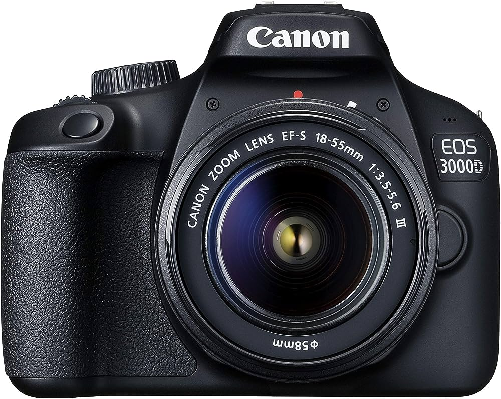
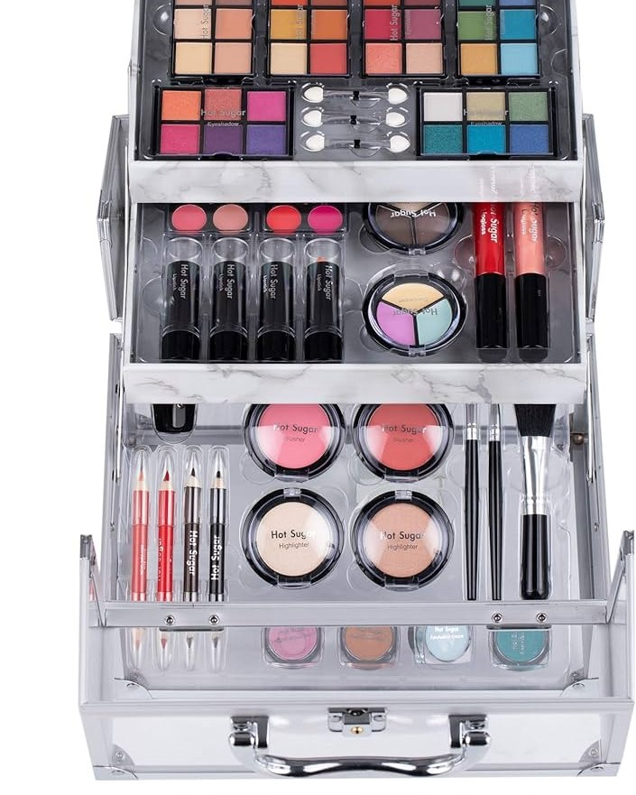
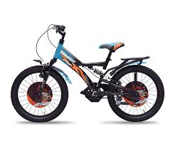
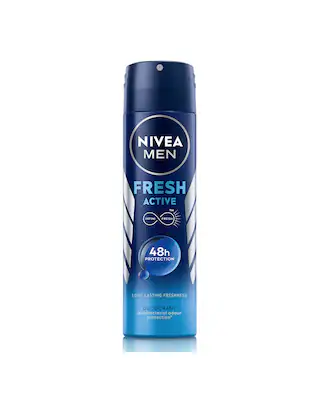

<div align="center">


# Myntra Storefront Clone

A lightweight shopping experience built with **HTML, CSS, and vanilla JavaScript**.

[](https://developer.mozilla.org/docs/Web/HTML)
[](https://developer.mozilla.org/docs/Web/CSS)
[](https://developer.mozilla.org/docs/Web/JavaScript)

**Browse products · Add to bag · Review your order**

</div>

---

## ✨ What you can do

| 🛍️ Shop | 👜 Manage your bag | 💾 Pick up where you left off |
|:--|:--|:--|
| Browse a product catalog with prices, ratings, and offers. | Add products, remove them, and see your order summary. | Bag items are saved in your browser with local storage. |

## 🖼️ Product gallery

A peek at the catalog included with this demo:

<p align="center">
  
  
  
  
  
</p>

## 🚀 Run it locally

No install or build step is needed.

1. Clone or download this repository.
2. Open `index.html` in a modern web browser.
3. Select **Add to Bag**, then open **Bag** to review your items.

> The bag is stored in the browser where you use the site. Clearing that browser's local storage clears the saved bag.

## 🧰 Built with

- **HTML** for the storefront and bag pages
- **CSS** for layout and styling
- **Vanilla JavaScript** for product rendering, bag actions, and order totals
- **Browser local storage** to save the bag between visits

## 📁 Project map

```text
.
├── index.html          # Storefront
├── pages/
│   └── bag.html        # Shopping bag and order summary
├── css/
│   ├── index.css       # Storefront styles
│   └── bag.css         # Bag page styles
├── data/
│   └── items.js        # Product catalog
├── scripts/
│   ├── index.js        # Catalog rendering and add-to-bag behavior
│   └── bag.js          # Bag rendering and order calculations
└── images/             # Product photos and Myntra logo
```

## 🧭 Start here

- [Open the storefront](index.html)
- [View the product catalog](data/items.js)
- [Open the bag page](pages/bag.html)

---

<div align="center">
  Made as a front-end learning project · Built with HTML, CSS & JavaScript
</div>
